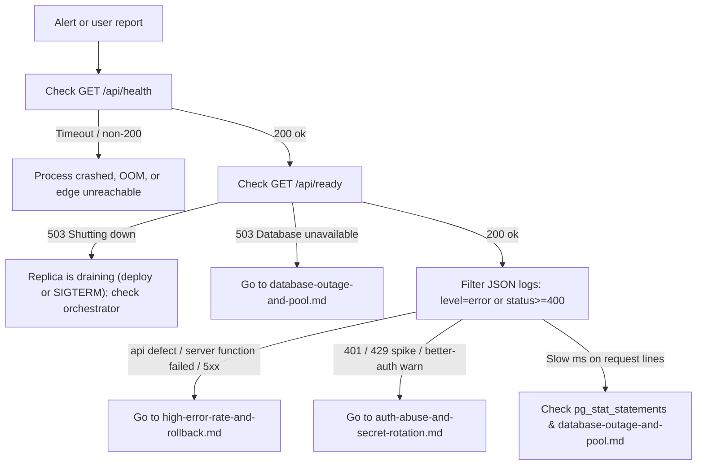

# Operations runbooks

Actionable playbooks for diagnosing and mitigating production incidents. All timestamps in server logs, incident timelines, and SQL queries use **UTC**.

## Runbook index

| Incident class | Runbook | Trigger signals |
| --- | --- | --- |
| Database outage, pool exhaustion, lock contention | [database-outage-and-pool.md](database-outage-and-pool.md) | `/api/ready` returns `503 Database unavailable`, `postgres pool error`, migration lock timeouts, `unsupported startup parameter` |
| 5xx spike, schema defects, bad release, drain issues | [high-error-rate-and-rollback.md](high-error-rate-and-rollback.md) | `api defect` (`ResponseSchemaError`), `server function failed`, `server function request failed`, `request error`, `uncaught exception, exiting` |
| Credential stuffing, rate-limit lockout, IP spoofing, secret leak | [auth-abuse-and-secret-rotation.md](auth-abuse-and-secret-rotation.md) | `429` bursts, `Rate limiting could not determine a client IP`, sign-up spam, compromised `BETTER_AUTH_SECRET` or DB/SMTP credentials |

Related references:

- Deployment, environment variables, backups, and restore drills: [operations.md](../operations.md)
- SLIs, SLOs, alert rules, profiling, and release patterns: [slos.md](../slos.md)
- Trust boundaries and STRIDE controls: [threat-model.md](../security/threat-model.md)

## First-5-minutes triage flow



### 1. Probe liveness and readiness

`GET /api/health` checks only the HTTP process (no DB). `GET /api/ready` checks both the draining flag and PostgreSQL (`select 1`, bounded by the 5 s `connectionTimeoutMillis` in `src/server/db/client.ts`).

```sh
# Liveness: expects 200 {"status":"ok"}
curl -fsS -i "$APP_URL/api/health"

# Readiness: expects 200 {"status":"ok"}
# On failure returns 503 {"_tag":"ServiceUnavailable","message":"Database unavailable"|"Shutting down"}
curl -sS -i "$APP_URL/api/ready"
```

### 2. Inspect structured JSON logs

In production, `src/server/log.ts` emits one JSON object per line (`time`, `level`, `msg`, plus fields and sanitized `error`). `level === "error"` writes to `stderr`; all other levels write to `stdout`.

| `msg` | Level | Source | Key fields | Meaning & next step |
| --- | --- | --- | --- | --- |
| `starting` | `info` | `src/server/nitro/startup.ts` | `appUrl`, `trustedProxies`, `databasePoolMax`, `databaseUrlPooled`, `permissionModel` | Confirms active startup config on each boot. |
| `request` | `info` / `error` | `src/server/nitro/http.ts` | `method`, `path`, `status`, `ms`, `aborted` | Per-request log (`status >= 500` is `error`; client disconnect is `info` with `status: 499, aborted: true`). Quiet on `<400` for `/api/health`, `/api/ready`, `/assets/*`, `/favicon*`. |
| `draining` | `info` | `src/server/nitro/startup.ts` | `signal` (`SIGTERM` / `SIGINT`) | Graceful drain started; `/api/ready` now returns `503` and responses include `Connection: close`. |
| `shutdown complete` | `info` | `src/server/lifecycle.ts` | `cleanups`, `steps`, `ms` | Ordered shutdown finished (`auth-cleanup`, `background-tasks`, `mailer`, `effect-api`, `postgres-pool`). |
| `shutdown cleanup failed` | `error` | `src/server/lifecycle.ts` | `cleanup`, `error` | One shutdown step threw; check which resource failed to drain cleanly. |
| `api defect` | `error` | `src/server/api/web-handler.ts` | `method`, `path`, `error` | Unexpected Effect API die, including `ResponseSchemaError` (logs schema paths, never values). Client got empty `500`. |
| `auth request failed` | `error` | `src/server/http/auth-handler.ts` | `path`, `error` | Better Auth handler threw (commonly DB outage or schema mismatch). Client got empty `500`. |
| `server function failed` | `error` | `src/lib/server-function-errors.ts` | `fn`, `error` | Server function threw an unhandled error; browser got `Error('Internal error')`. |
| `server function request failed` | `error` | `src/lib/server-function-errors.ts` | `path`, `error` | `/_serverFn/<id>` failed before running—often stale browser tabs after a deploy ([ADR 0009](../decisions/0009-unknown-server-function-id.md)). |
| `request error` | `error` | `src/server/nitro/startup.ts` | `tags`, `method`, `path`, `error` | Uncaught error reached Nitro's `error` hook; Nitro answered bare JSON `500`. |
| `postgres pool error` | `error` | `src/server/db/client.ts` | `error` | An idle connection in the `pg` pool failed (DB restart, network blip, or `pg_terminate_backend`). |
| `background task failed` | `error` | `src/server/background-tasks.ts` | `error` | Post-response work (SMTP mail send, `rate_limit` prune, auth cleanup) rejected. |
| `uncaught exception, exiting` | `error` | `src/server/nitro/startup.ts` | `error` | Fatal process bug; process exits with code `1` so the supervisor restarts it. |
| `unhandled rejection` | `error` | `src/server/nitro/startup.ts` | `error` | Unhandled promise rejection; logged while process continues. |
| `mail not delivered: SMTP_URL is unset` | `warn` | `src/server/mail/log-mailer.ts` | `subject` (prod) | `SMTP_URL` is unset; account emails are not being delivered. |
| `Rate limiting could not determine a client IP ...` | `warn` | `src/server/auth.ts` (`source: "better-auth"`) | `source` | Every `X-Forwarded-For` hop matched `TRUSTED_PROXIES`; check proxy CIDR config. |

Quick `jq` filters for container or pod logs (ignore non-JSON srvx startup/shutdown lines with `-R 'fromjson? | select(type == "object")'`):

```sh
# All error-level JSON events in the last 15 minutes (Docker Compose example)
docker compose -f compose.production.yaml --env-file deploy.env logs --since 15m app \
  | jq -R 'fromjson? | select(type == "object" and .level == "error")'

# Group error messages by count
kubectl logs -l app.kubernetes.io/name=app --since=15m \
  | jq -R 'fromjson? | select(type == "object" and .level == "error") | .msg' \
  | sort | uniq -c | sort -rn

# Slowest requests (>500 ms), excluding client aborts
kubectl logs -l app.kubernetes.io/name=app --since=15m \
  | jq -R 'fromjson? | select(type == "object" and .msg == "request" and (.ms // 0) > 500 and .aborted != true)'
```

### 3. Check PostgreSQL query hot spots (`pg_stat_statements`)

`pg_stat_statements` is preloaded in `deploy/compose.production.yaml` and created by `deploy/postgres-init.sh` (enabled in managed Postgres consoles).

```sql
-- Top 15 queries by total execution time
SELECT
  calls,
  round(total_exec_time::numeric, 1) AS total_ms,
  round(mean_exec_time::numeric, 1) AS mean_ms,
  rows,
  left(query, 140) AS query_sample
FROM pg_stat_statements
ORDER BY total_exec_time DESC
LIMIT 15;

-- Currently active or stuck queries (>2 s)
SELECT
  pid,
  application_name,
  state,
  wait_event_type,
  wait_event,
  now() - query_start AS duration,
  left(query, 120) AS query_sample
FROM pg_stat_activity
WHERE datname = current_database()
  AND pid <> pg_backend_pid()
  AND state <> 'idle'
ORDER BY duration DESC;
```

## Incident hygiene

1. **Mitigate first, root-cause second:** stabilize `/api/ready`, error rate, or auth abuse before deep profiling.
2. **Never paste secrets or PII into tickets or chat:** logs already strip cookies, headers, and SQL parameters (`tests/integration/db-failure.test.ts`), so avoid dumping raw `user`, `session`, or `verification` rows.
3. **Record UTC timestamps** for detection, mitigation, rollback/config change, and full recovery.
4. **Capture evidence before restarting** a sick pod/container (logs, `pg_stat_activity` snapshot, or CPU/heap profile per [slos.md](../slos.md#3-production-node-profiling-adr-0012-compatible)).
