# Threat model

Security architecture, trust boundaries, STRIDE threat mapping, and review checklist for this application. Pair this document with [operations.md](../operations.md) for deployment hardening, [slos.md](../slos.md) for reliability guardrails, and [runbooks/README.md](../runbooks/README.md) for incident response.

## Trust boundaries and data flow

Every request crosses up to four trust boundaries before reaching PostgreSQL or SMTP. Authorization never relies on the UI or route guards alone: `_authed` (`src/routes/_authed.tsx`) is a UX redirect, while enforcement happens on the server.

```mermaid
flowchart LR
  subgraph Internet["Untrusted: Internet"]
    Browser["Browser / API Client"]
  end

  subgraph Edge["Boundary 1: Edge Proxy (deploy/Caddyfile)"]
    Caddy["Caddy (TLS, HTTP/2, zstd/gzip, trusted_proxies_strict)"]
  end

  subgraph Runtime["Boundary 2: Node Process (--permission, ADR 0012)"]
    Nitro["Nitro HTTP Hook (Security Headers, CSP, Drain, JSON Logs)"]
    StartMW["Start Request Middleware (src/start.ts: ServerFn Errors, CSRF, 64 KiB Body Limit)"]

    subgraph Surfaces["Boundary 3: Request Surfaces (ADR 0013)"]
      Pages["SSR / Prerendered Pages & ServerFn (src/lib/*.functions.ts)"]
      AuthHTTP["Better Auth Allowlist (/api/auth/*: 3 HTTP endpoints)"]
      HttpApi["Effect HttpApi (/api/*: Authentication, RequestValidation, WriteRateLimit)"]
    end
  end

  subgraph Backing["Boundary 4: Backing Services"]
    Postgres["PostgreSQL 18 (Drizzle, UNLOGGED rate_limit, non-superuser app role)"]
    SMTP["SMTP Mailer (TLS/STARTTLS, async background task)"]
  end

  Browser -->|"HTTPS (Origin, Sec-Fetch-Site, Cookie)"| Caddy
  Caddy -->|"HTTP + single client_ip X-Forwarded-For"| Nitro
  Nitro --> StartMW
  StartMW --> Pages
  StartMW --> AuthHTTP
  StartMW --> HttpApi
  Pages -->|"callAuthEndpoint (in-process)"| AuthHTTP
  Pages -->|"in-process SSR dispatch"| HttpApi
  AuthHTTP -->|"Drizzle + rate_limit upsert"| Postgres
  AuthHTTP -->|"verification / reset links"| SMTP
  HttpApi -->|"Parameterized SQL (keyset + author scope)"| Postgres
```

### Trust boundary summary

| Boundary | Enforcement point | What it guarantees |
| --- | --- | --- |
| Internet → Edge | `deploy/Caddyfile` (`trusted_proxies_strict`, `header_up X-Forwarded-For {client_ip}`, no response cache, admin API off) | TLS termination, stripped spoofed `X-Forwarded-For` chains, untouched `Set-Cookie`/`Cache-Control`/`Origin`/`Sec-Fetch-*`. |
| Edge → Node Runtime | `Dockerfile` (`USER node`, `--permission --allow-fs-read=/app/.output --allow-net`, [ADR 0012](../decisions/0012-node-permission-model.md)), `deploy/kubernetes.yaml` (`readOnlyRootFilesystem: true`, `capabilities.drop: [ALL]`), `src/server/nitro/http.ts` | Process cannot write files, spawn shells/workers, or load native addons; every response gets baseline security headers and strict CSP. |
| Request → Start Middleware | `src/start.ts`, `src/lib/server-function-errors.ts` | Every non-`GET`/`HEAD`/`OPTIONS` request passes CSRF (`Sec-Fetch-Site: same-origin` or `Origin`/`Referer === APP_URL`) and 64 KiB `Content-Length` / no-chunked checks before auth or handler code runs. |
| Middleware → Three Surfaces | [ADR 0013](../decisions/0013-three-request-surfaces.md): `src/server/http/auth-endpoints.ts`, `src/server/api/middleware.ts`, `src/lib/auth.functions.ts` | `/api/auth/*` exposes only 3 HTTP endpoints (404 elsewhere); account actions validate narrowed Effect Schemas in server functions; `/api/me/*` requires `Authentication` + `WriteRateLimit`. |
| App → Postgres / SMTP | `src/server/db/client.ts`, `src/server/posts/repo.ts`, `src/server/env.ts`, `deploy/postgres-init.sh` | Non-superuser `app` role, role/connection `statement_timeout` (15 s) and `idle_in_transaction_session_timeout` (30 s), parameterized Drizzle queries, `Redacted` secrets, TLS verification. |

## Assets to protect

| Asset | Location | Sensitivity | Primary risk |
| --- | --- | --- | --- |
| Session cookies & tokens | `session` table, `(__Secure-)better-auth.session_token` cookie | Critical | Session hijacking, CSRF, token leakage in JSON/logs |
| Password hashes & auth secrets | `account.password`, `BETTER_AUTH_SECRET` (`Redacted`) | Critical | Credential stuffing, secret disclosure, forged cookies |
| Verification & reset tokens | `verification` table, outbound email links | High | Account takeover, link-scanner auto-confirmation, enumeration |
| Database & SMTP credentials | `DATABASE_URL`, `MIGRATION_DATABASE_URL`, `SMTP_URL` (`Redacted`) | Critical | Full data compromise, unauthorized mail relay |
| Author posts & user profiles | `post`, `user` tables | Medium | Cross-user modification/deletion (IDOR/BOLA), stored XSS |
| Rate-limit counters & IP metadata | `rate_limit` (`UNLOGGED`), `session.ip_address` | Medium | Brute-force bypass via header spoofing, PII retention |
| Audit trail & telemetry *(Wave 2)* | `audit_log` table, `/metrics` endpoint | Medium | Log/metric tampering, PII leakage, unauthenticated metric scraping |

## STRIDE threat matrix

Controls marked *(Wave 2)* correspond to the companion observability and audit primitives (`src/server/audit/audit-log.ts`, `src/server/request-context.ts`, `src/server/observability/telemetry.ts`) wired during Wave 2 integration.

| STRIDE | Threat & target asset | Implemented controls (source of truth) | Automated verification |
| --- | --- | --- | --- |
| **Spoofing** | **Session forgery or cookie theft** via XSS, plain HTTP, or cross-site scripts | `HttpOnly`, `SameSite=Lax`, 7-day expiry, `__Secure-` + `Secure` when `APP_URL` is `https://` (`src/server/auth.ts`); session tokens stripped from `/api/auth/*` JSON responses (`withoutSessionTokens` in `src/server/http/auth-handler.ts`) and never returned by `listSessions` (`src/lib/auth.functions.ts`). | `tests/integration/security.test.ts`, `tests/integration/auth-account.test.ts`, `tests/integration/auth-session-refresh.test.ts` |
| **Spoofing** | **Cross-Site Request Forgery (CSRF)** on state-changing pages, `/_serverFn/*`, `/api/*`, `/api/auth/*` | Global `createCsrfMiddleware` in `src/start.ts` checks every non-`GET`/`HEAD`/`OPTIONS` request: requires `Sec-Fetch-Site: same-origin`, or exact `Origin`/`Referer === APP_URL` when absent; rejects missing headers with `403` before auth runs. | `tests/integration/security.test.ts` (`describe('csrf')`) |
| **Spoofing** | **Client IP spoofing** via forged `X-Forwarded-For` to bypass auth rate limits or fake session IPs | Caddy uses `trusted_proxies_strict` and rewrites `X-Forwarded-For` to `{client_ip}` (`deploy/Caddyfile`); `forwardedFor` (`src/server/http/forwarded-for.ts`) appends TCP peer and drops incoming chains when `TRUSTED_PROXIES` is empty; Better Auth walks right-to-left with `ipv6Subnet: 64` (`src/server/auth.ts`, `src/server/http/client-address.ts`). | `tests/unit/forwarded-for.test.ts`, `tests/unit/client-address.test.ts`, `tests/integration/auth-client-ip.test.ts`, `tests/integration/security.test.ts` |
| **Spoofing** | **Open redirect / phishing** via login `redirect` parameter or protocol-relative paths | `safeRedirect` (`src/features/auth/utils/safe-redirect.ts`) enforces leading `/`, rejects backslashes, `//`, decoded protocol/path bypasses, `/login`, `/api/*`, and lengths > 2048. | `tests/unit/safe-redirect.test.ts`, `tests/integration/security.test.ts` (`does not redirect to other hosts`) |
| **Spoofing** | **Account enumeration** via sign-up, password reset, sign-in, or timing side channels | Identical responses for unknown email vs wrong password; neutral answers on sign-up/reset/resend; mail dispatched asynchronously in `advanced.backgroundTasks` (`src/server/auth.ts`, `src/server/background-tasks.ts`); email verification requires explicit POST button click (resists mail scanners). | `tests/integration/security.test.ts`, `tests/integration/auth-sign-up.test.ts`, `tests/e2e/auth-lifecycle.spec.ts` |
| **Tampering** | **XSS / script or style injection** in SSR or prerendered HTML | Strict CSP with zero `'unsafe-inline'` or `'unsafe-eval'` ([ADR 0010](../decisions/0010-content-security-policy.md), `src/lib/content-security-policy.ts`): per-request 128-bit nonce + `'strict-dynamic'` on SSR (`src/router.tsx`), parse5 SHA-256 hashes on prerendered routes (`src/server/nitro/prerender-csp.ts`, failing build on inline `style`/`on*`), locked-down `default-src 'none'` on non-documents (`src/server/nitro/http.ts`). | `tests/unit/content-security-policy.test.ts`, `tests/unit/prerender-csp.test.ts`, `tests/integration/csp.test.ts`, `tests/e2e/csp.spec.ts`, `tests/e2e/fixtures.ts`, `tests/bombadil/app.ts` (`noCspViolations`) |
| **Tampering** | **SQL injection or NUL-byte / malformed input injection** into Postgres | All queries use parameterized Drizzle ORM (`src/server/posts/repo.ts`, `src/server/auth-rate-limit.ts`); every stored/queried string enforces `isFreeOfNul` (`src/contract/stored-text.ts`) + length bounds (`src/contract/limits.ts`) + branded IDs (`src/contract/ids.ts`); server functions enforce `Schema.toStandardSchemaV1(...)` via Oxlint rule; Postgres CHECK constraints (`trimmedTextCheck` in `src/server/db/schema/posts.ts`). | `tests/unit/stored-text.test.ts`, `tests/unit/id-brands.test.ts`, `tests/unit/account-input.test.ts`, `tests/api/posts-validation.test.ts`, `tests/db/post-schema.test.ts` |
| **Tampering** | **Clickjacking, MIME sniffing, or cross-origin framing** | Baseline headers on every production response (`src/server/nitro/http.ts`): `X-Frame-Options: DENY`, `frame-ancestors 'none'`, `X-Content-Type-Options: nosniff`, `Cross-Origin-Opener-Policy: same-origin`, `Cross-Origin-Resource-Policy: same-origin`, `Referrer-Policy: strict-origin-when-cross-origin`, `Permissions-Policy`, HSTS + `upgrade-insecure-requests` on HTTPS. | `tests/integration/security.test.ts`, `tests/integration/csp.test.ts` |
| **Tampering** | **Supply-chain or migration tampering** (malicious npm package, postinstall scripts, retroactive migration edits) | Exact dependency pins (`savePrefix: ''`), 24 h `minimumReleaseAge`, `trustPolicy: no-downgrade`, empty `allowBuilds`, `pnpm audit signatures`, `pnpm audit:check`, Grype container scan, digest-pinned base/CI images (`scripts/images.ts`), immutable applied migrations check, `fallow security` sink gate. | `tests/unit/repo-policy.test.ts`, `pnpm ci:supply-chain`, `pnpm ci:workflows`, `pnpm ci:docker`, `pnpm check` (`security`, `migrations`, `licenses`) |
| **Repudiation** | **Unattributable auth or account changes / missing error forensics** | One-JSON-line structured server logs (`src/server/log.ts`) on stdout/stderr capturing `request`, `api defect`, `auth request failed`, `server function failed`, `draining`, `shutdown complete`, and Better Auth warnings (`source: "better-auth"`); session rows record client IP (/64 for IPv6) and user agent (`src/server/db/schema/auth.ts`). *(Wave 2)* `audit_log` (`src/server/db/schema/audit-log.ts`, `src/server/audit/audit-log.ts`) appends tamper-evident security events (`action`, `actor_id`, salted `ip_hash`, `request_id`, `outcome`, sanitized `metadata`) correlated with W3C `traceparent` / `requestId` (`src/server/request-context.ts`). | `tests/integration/shutdown.test.ts`, `tests/integration/db-failure.test.ts`, `tests/db/auth-cleanup.test.ts` *(Wave 2: `tests/unit/audit-log.test.ts`, `tests/unit/request-context.test.ts`)* |
| **Information Disclosure** | **Secret, SQL parameter, or stack trace leakage** in HTTP responses or logs | Secrets wrapped in Effect `Redacted` (`src/server/env.ts`); `log()` keeps only first line of error messages and stack frames (`src/server/log.ts`) so Drizzle/pg SQL params are stripped; Effect API defects return empty `500` (`src/server/api/web-handler.ts`, `ResponseSchemaError` logs paths only); server functions return generic `Error('Internal error')` (`src/lib/server-function-errors.ts`, [ADR 0009](../decisions/0009-unknown-server-function-id.md)); production log-only mailer omits links/recipients; Betterleaks scans full git history. | `tests/integration/db-failure.test.ts`, `tests/integration/security.test.ts`, `tests/unit/env.test.ts`, `pnpm ci:secrets` |
| **Information Disclosure** | **Cross-user response caching or SSR state bleed** | Per-request TanStack Router and QueryClient (`src/router.tsx`); SSR pages send `Cache-Control: private, no-store`; `/api/*` and `/api/auth/*` default to `no-store` (`src/server/api/web-handler.ts`, `src/server/http/auth-endpoints.ts`); Caddy has no response cache (`deploy/Caddyfile`). | `tests/integration/security.test.ts`, `tests/integration/assets.test.ts`, `tests/api/ssr-requests.test.ts` |
| **Information Disclosure** | **Unauthenticated metrics scraping or PII over-retention** | Periodic cleanup deletes expired sessions > 7 days old and expired verification tokens (`src/server/auth-cleanup.ts`); `rate_limit` prunes idle rows after 10 min; deleting an account cascades `session`, `account`, `post`. *(Wave 2)* `/metrics` (`src/server/observability/telemetry.ts`) must never be exposed publicly without a bearer token guard (`METRICS_TOKEN`) or internal-only network/port restriction, and never places user IDs, emails, or raw paths into metric labels. | `tests/db/auth-cleanup.test.ts`, `tests/integration/auth-account.test.ts` *(Wave 2: `tests/unit/telemetry.test.ts`)* |
| **Denial of Service** | **Credential brute force, auth spam, or API write flooding** | Shared Postgres `rate_limit` (`UNLOGGED`, atomic `INSERT ... ON CONFLICT DO UPDATE`, `src/server/auth-rate-limit.ts`): auth limits (3/10 s on sign-in/sign-up/change-password, 3/60 s on reset/verify, 100/60 s other exposed endpoints) and per-user API write limit (60/60 s across `POST`/`PATCH`/`DELETE /api/me/posts` via `WriteRateLimit` in `src/server/api/rate-limit.ts`). `AUTH_SIGN_UP=closed` by default ([ADR 0003](../decisions/0003-sign-up-policy.md)). | `tests/db/auth-rate-limit.test.ts`, `tests/integration/auth-rate-limit.test.ts`, `tests/integration/posts-rate-limit.test.ts`, `tests/integration/security.test.ts`, `specs/RateLimit.tla` (`pnpm verify:tla`) |
| **Denial of Service** | **Oversized payloads, slowloris/chunked streams, or runaway SQL queries** | `bodyLimit` in `src/start.ts` enforces 64 KiB max `Content-Length` (`413`), rejects non-numeric `Content-Length` (`400`), and rejects chunked bodies (`411`); Postgres role/pool enforces `statement_timeout = 15s`, `idle_in_transaction_session_timeout = 30s`, `connectionTimeoutMillis = 5000`, bounded `DATABASE_POOL_MAX` (`src/server/db/client.ts`); keyset pagination bounded by `POSTS_PAGE_MAX = 50` (`src/contract/limits.ts`, [ADR 0014](../decisions/0014-uuidv7-ids-keyset-on-created-at.md)); DDL locks bounded by `MIGRATE_DDL_LOCK_TIMEOUT = 5s` (`scripts/migrate.ts`). | `tests/integration/security.test.ts`, `tests/db/keyset.test.ts`, `tests/db/posts-query-budget.test.ts`, `tests/db/migrate.test.ts`, `specs/KeysetPagination.tla` |
| **Elevation of Privilege** | **Unauthenticated access to business API endpoints** | Every `/api/me/*` operation sits behind Effect `Authentication` middleware (`src/server/api/middleware.ts`); `tests/api/public-operations.test.ts` automatically asserts every contract endpoint returns `401` without a session unless explicitly listed in `PUBLIC_OPERATIONS`. | `tests/api/public-operations.test.ts`, `tests/api/middleware.test.ts`, `tests/unit/openapi-rules.test.ts` |
| **Elevation of Privilege** | **Broken Object-Level Authorization (IDOR / BOLA)** on posts or sessions | `PostsRepo.update` and `PostsRepo.remove` scope SQL `WHERE` clauses by both `post.id` and `post.authorId === CurrentUser.id` (`src/server/posts/repo.ts`); `revokeSession` resolves `data.id` only against the caller's own `listRaw()` sessions (`src/lib/auth.functions.ts`). | `tests/api/posts.test.ts`, `tests/api/me.test.ts`, `tests/integration/posts.test.ts`, `tests/integration/auth-account.test.ts` |
| **Elevation of Privilege** | **Hidden Better Auth routes or passwordless account deletion** | `endpointAllowlist` (`src/server/http/auth-endpoints.ts`) returns `404` for every non-allowlisted path; raw HTTP `/api/auth/*` allows only 3 endpoints (`HTTP_ENDPOINTS`); `requirePasswordToDelete` (`src/server/auth.ts`) blocks `/delete-user` without a password even for fresh sessions; `AUTH_SIGN_UP=closed` disables `/sign-up/email`. | `tests/integration/security.test.ts` (`describe('auth surface')`), `tests/integration/auth-account.test.ts`, `tests/integration/auth-sign-up.test.ts`, `tests/e2e/auth-closed.spec.ts` |
| **Elevation of Privilege** | **RCE / container escape / filesystem tampering after compromise** | Runtime image strips `npm`/`npx`/`yarn`, runs as non-root `node` (uid 1000) with root-owned `.output/`, enforces Node `--permission --allow-fs-read=/app/.output --allow-net` ([ADR 0012](../decisions/0012-node-permission-model.md)); Kubernetes manifest sets `readOnlyRootFilesystem: true`, `allowPrivilegeEscalation: false`, `capabilities.drop: [ALL]`, `seccompProfile: RuntimeDefault` (`deploy/kubernetes.yaml`); DB runs as non-superuser `app` role (`deploy/postgres-init.sh`). | `tests/integration/shutdown.test.ts` (`permissionModel: true`), `pnpm ci:docker`, `pnpm ci:workflows` (kubeconform) |

## Agent security review checklist

Run this checklist before finishing any change touching endpoints, server functions, schemas, migrations, auth, CSP, or deployment configuration (see also `.agents/skills/security-review/SKILL.md`).

### 1. New HTTP API endpoints (`src/contract/`, `src/server/api/`)

- [ ] Business operations live in Effect `HttpApi` ([ADR 0013](../decisions/0013-three-request-surfaces.md)), never as ad-hoc Start server routes (`src/routes/api/` allows only `$.ts` and `auth/$.ts`).
- [ ] Authenticated routes sit under `/api/me/*` behind `Authentication`; any new unauthenticated route is deliberately added to `PUBLIC_OPERATIONS` in `tests/api/public-operations.test.ts` with justification.
- [ ] Write endpoints attach `WriteRateLimit` (or a dedicated rate-limit middleware) and `RequestValidation`.
- [ ] Repository queries scope reads/updates/deletes by `CurrentUser.id` (no IDOR/BOLA) and return `404` rather than leaking existence of another user's resource.
- [ ] Response schemas omit secrets, password hashes, session tokens, and internal fields; `openapi.json` and `src/sdk` are regenerated via `pnpm codegen`.

### 2. Server functions (`src/lib/*.functions.ts`)

- [ ] Used only for account actions (`callAuthEndpoint`), route guards, or small UI-only reads ([ADR 0013](../decisions/0013-three-request-surfaces.md)).
- [ ] Every input uses `.validator(Schema.toStandardSchemaV1(...))` with narrowed fields (never pass raw request bodies to Better Auth).
- [ ] Expected failures return typed values (`AuthOutcome`), while unexpected errors rely on `serverFunctionErrors` (`src/lib/server-function-errors.ts`) to emit generic `Error('Internal error')` to clients.
- [ ] Session-specific `GET` server functions set `Cache-Control: private, no-store`.
- [ ] Account actions stay out of `HTTP_ENDPOINTS` (`src/server/http/auth-endpoints.ts`) unless a non-browser API client specifically needs them.

### 3. Schemas, logging, and secrets

- [ ] Every user-supplied string stored or queried in Postgres starts with `isFreeOfNul` (`src/contract/stored-text.ts`) and has explicit min/max length bounds in `src/contract/limits.ts`.
- [ ] Entity IDs use branded schemas from `src/contract/ids.ts`, never raw `Schema.String`.
- [ ] New environment secrets are parsed in `src/server/env.ts` as `Redacted.Redacted` and validated at startup without echoing secret values in error messages.
- [ ] Logs go through `log()` (`src/server/log.ts`) and never include emails, passwords, cookies, tokens, Authorization headers, or raw request bodies.
- [ ] Any new redirect target passes through `safeRedirect` (`src/features/auth/utils/safe-redirect.ts`).

### 4. Database schemas and migrations (`src/server/db/schema/`, `drizzle/`)

- [ ] New tables have explicit indexes supporting every query path (no sequential scans on hot tables) and query-budget tests in `tests/db/`.
- [ ] Migrations are forward-only and expand/contract compatible with the previous app build during rolling deploys.
- [ ] `pnpm check:migrations` (squawk) passes with zero findings; any waiver has a rationale comment directly above `-- squawk-ignore`.
- [ ] Large-table index creation uses the manual `CREATE INDEX CONCURRENTLY` workflow ([operations.md](../operations.md#migration-safety)).
- [ ] Personal data columns have a documented retention/deletion path (cascade on user delete or periodic cleanup).

### 5. CSP, runtime permissions, and deploy config (`deploy/`, `Dockerfile`, `vite.config.ts`)

- [ ] No `'unsafe-inline'`, `'unsafe-eval'`, inline `style="..."`, or `on*` attributes in markup ([ADR 0010](../decisions/0010-content-security-policy.md)).
- [ ] No new filesystem writes, child processes, workers, or native addons that break Node `--permission` ([ADR 0012](../decisions/0012-node-permission-model.md)) or Kubernetes `readOnlyRootFilesystem: true`.
- [ ] Proxy configs preserve `Host`, `Origin`, `Referer`, `Sec-Fetch-*`, strip untrusted `X-Forwarded-For` hops (`trusted_proxies_strict`), and match `TRUSTED_PROXIES`.
- [ ] New container images or GitHub Actions are pinned by full digest / 40-char commit SHA.
- [ ] `pnpm check` (including `fallow security`, `repo-policy`, `migrations`, `licenses`) and relevant integration/E2E security tests pass.
